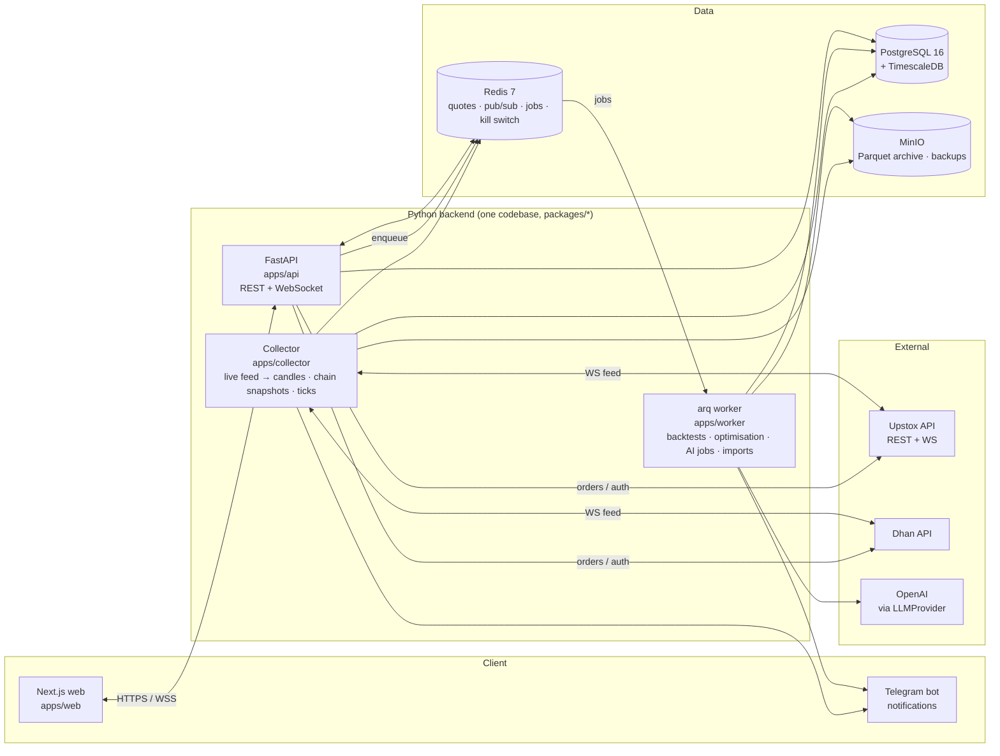
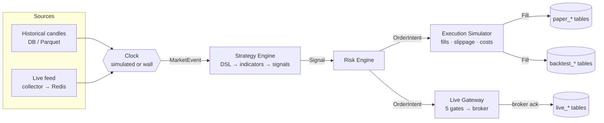
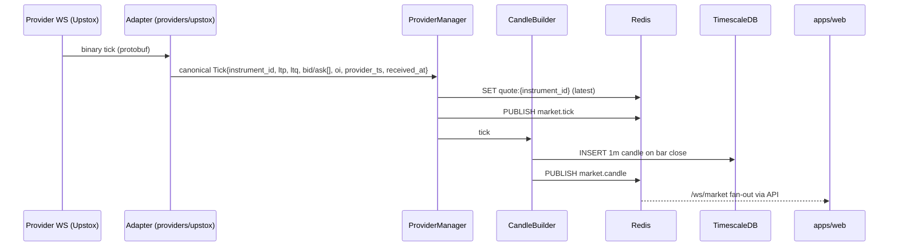
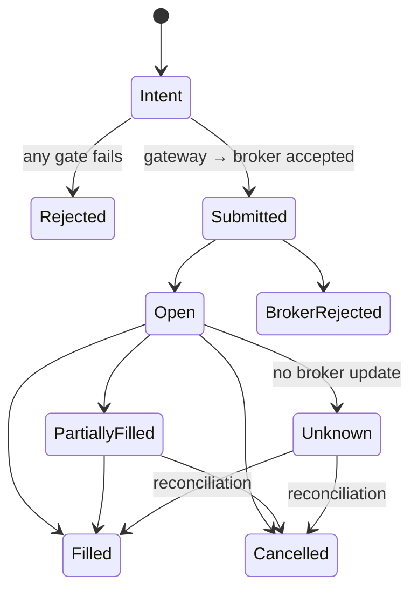

# 01 · System Architecture

Source of requirements: `docs/MASTER_PROMPT.md`. Decisions: `docs/adr/`.

## 1. Shape of the system

A **modular monolith** (ADR-001): one Python codebase deployed as three processes, one
Next.js frontend, one Postgres/TimescaleDB, one Redis, one object store.



**Why three processes and not one:** the collector must keep storing candles while the
API or worker is redeployed; the worker must not compete with request latency. They share
every package, so this is a deployment split, not a service split.

## 2. Package layering

Dependencies point downward only. CI enforces this with import-linter.

```
┌──────────────────────────────────────────────────────────────┐
│ apps/api · apps/worker · apps/collector  (wiring, no logic)  │
├──────────────────────────────────────────────────────────────┤
│ packages/ai        packages/portfolio      packages/backtest  │  ← use-cases
├──────────────────────────────────────────────────────────────┤
│ packages/strategy  packages/execution  packages/risk          │  ← domain engines
├──────────────────────────────────────────────────────────────┤
│ packages/market_data (canonical access, provider manager)     │
├──────────────────────────────────────────────────────────────┤
│ packages/providers/upstox · dhan · fake   (adapters only)     │
├──────────────────────────────────────────────────────────────┤
│ packages/core  (models, events, calendar, time, config, db)   │
└──────────────────────────────────────────────────────────────┘
```

| Package | Owns | Must not import |
|---|---|---|
| `core` | Canonical Pydantic models (Instrument, Candle, Tick, Quote, OptionChain, Order, Fill, Position, Signal), event bus, calendar/sessions, time utils, settings, DB session, logging | anything above it |
| `providers/*` | One adapter per provider: auth, REST, WS, instrument master, mapping to canonical models, rate limiting | `strategy`, `execution`, `backtest`, `ai` |
| `market_data` | `MarketDataProvider` interface, `ProviderManager` (single / comparison / failover), historical manager, imports, quality checks, candle builder | `strategy`, `execution` |
| `strategy` | DSL schema + validation, indicator library, strategy engine (event → signals), regime detector | `execution`, `backtest`, `ai` |
| `execution` | Order state machine, `ExecutionSimulator` (fills, slippage, costs), live `gateway` (single entry, five gates), OMS, reconciliation | `backtest`, `ai` |
| `risk` | Position sizing, limits, exposure/correlation checks, kill switch, event block | `backtest`, `ai` |
| `backtest` | Event-driven runner, metrics, optimisation, walk-forward, replay session | `ai` |
| `portfolio` | Accounts, positions, P&L, snapshots, analytics, journal | `ai` |
| `ai` | `LLMProvider` interface, NL strategy builder, research jobs, trade review, morning brief, auditor | nothing forbidden, but may only *write* `draft` strategy versions and report records |

## 3. The one engine (ADR-002)



- **Backtest**: historical source, simulated clock, simulator, writes `backtest_*`.
- **Replay**: historical source, simulated clock at user speed, simulator, writes to an
  ephemeral replay session (optionally persisted as a backtest).
- **Paper**: live source, wall clock, simulator, writes `paper_*`.
- **Live**: live source, wall clock, gateway, writes `live_*`.

The engine, risk engine and simulator have no idea which mode they are in. Mode is a
binding chosen at activation time (`strategy_activations.trading_mode`).

### Determinism rules
- Indicators are computed on **closed** bars only. The engine receives a bar when it closes.
- Fills in the simulator use the next event after the signal, never the signal bar's close.
- Slippage and partial fills are drawn from a seeded RNG stored with the backtest job.
- Costs come from `cost_schedules` by trade date (ADR-011).

## 4. Market data path



- Every canonical record carries `provider_id`, `provider_ts`, `received_at` and a
  `freshness` computed at read time (`live` < 2 s, `delayed` < 30 s, else `stale`;
  `disconnected` when no heartbeat; `demo` when from the fake provider).
- **Comparison mode** runs two adapters; both write to `market_quotes` tagged by provider,
  one is `primary` for consumers. **Failover mode** promotes the secondary when the
  primary misses heartbeats for N seconds and logs a `provider_switch` audit event; it never
  switches back automatically within the same session.
- Historical candles for other timeframes are **derived** from 1-minute (and from provider
  daily candles for pre-intraday history), stored with `derived_from` set.

## 5. Order and safety path (live)



- One function places live orders (ADR-007). Transitions after `Submitted` come **only**
  from broker callbacks or the reconciliation job, never from our own assumptions.
- Idempotency key = `strategy_version_id:signal_id`; a repeat is a no-op returning the
  existing order.
- Kill switch: Redis flag `kill:global`, `kill:account:{id}`, `kill:strategy:{id}` checked on
  every submit; setting it also triggers "cancel all open, optionally flatten" as a job
  and writes `kill_switch_events`.
- Reconciliation job every 60 s during session: broker orders/positions vs ours. Mismatch
  → alert + live trading paused for that account until acknowledged.

## 6. AI boundaries (ADR-009)

| Agent (scheduled job) | Reads | Writes | May never |
|---|---|---|---|
| Market Analyst (08:45 IST) | candles, VIX, OI, events, regime detector output | `morning_briefs` | change which strategies run |
| Strategy Translator (on request) | user text, DSL schema, indicator catalogue | `strategy_versions` (status `draft`) + clarification questions | alter user conditions silently |
| Strategy Researcher (nightly / weekend) | historical data, library, prior results | `ai_research_jobs`, `backtest_jobs`, draft versions, reports | promote beyond `draft` |
| Trade Reviewer (on trade close) | the trade, context, last N trades | `trade_reviews`, improvement hypotheses | modify strategies |
| Execution Monitor (session hours, deterministic rules) | order/feed/reconciliation state | alerts, kill switch **on** only via hard rules | turn trading on |
| Auditor (nightly) | all of the above outputs + raw data | `audit_findings` | anything else |

All calls go through `LLMProvider` with JSON Schema, Pydantic validation, logging to
`ai_calls` (model, prompt version, tokens, cost, input record ids) and a per-job budget.

## 7. Strategy lifecycle

```
draft ──backtest ok──▶ backtested ──walk-forward/OOS ok──▶ validated
  ──paper ≥ N weeks & within expectations──▶ paper_proven
  ──user approval (signed)──▶ approved_live ──▶ retired
```

- Versions are immutable after leaving `draft`. Any edit clones into a new `draft`.
- Approval records store who, when, the backtest and paper evidence ids, and the risk
  limits at approval time.
- AI can create versions only in `draft`.

## 8. Cross-cutting

- **Auth**: email+password (Argon2), JWT access (15 min) + refresh rotation, optional TOTP;
  roles owner/trader/viewer (ADR-014). All routes authenticated except health and auth.
- **Secrets**: broker credentials encrypted (Fernet) with `SECRETS_KEY` from env; never
  logged; never returned by any API.
- **Audit**: every state-changing request writes `audit_logs` (user, action, entity, before/
  after hash, ip). Order and strategy status changes additionally have their own event tables.
- **Observability**: structlog JSON → stdout; Sentry for exceptions; Prometheus metrics
  endpoint (`/metrics`) for feed latency, reconnects, job queue depth, order round-trip.
- **Notifications**: Telegram bot for token expiry, kill switch, reconciliation mismatch,
  daily summary (ADR-012).
- **Time**: ADR-006.
- **Config**: pydantic-settings; `.env.example` is the documentation.

## 9. Deployment

Local: `docker compose up` (db, redis, minio) + `uv run` processes + `pnpm dev`.
VPS (Mumbai region): same compose file plus `api`, `worker`, `collector`, `web`, `nginx`
services; Nginx terminates TLS and proxies `/api` and `/ws`. Backups: nightly `pg_dump` to
MinIO, weekly restore test job that reports to Telegram.

## 10. What is explicitly out of scope for v1

Python strategy editor (ADR-003), news/sentiment (ADR-013), raw tick/depth archive on by
default (ADR-010), multi-tenant sign-up (ADR-014), non-NSE exchanges (adapters interface
only), microservices.
