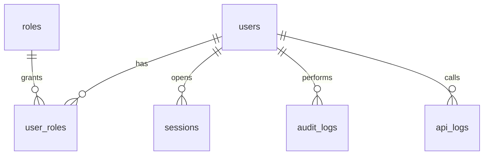
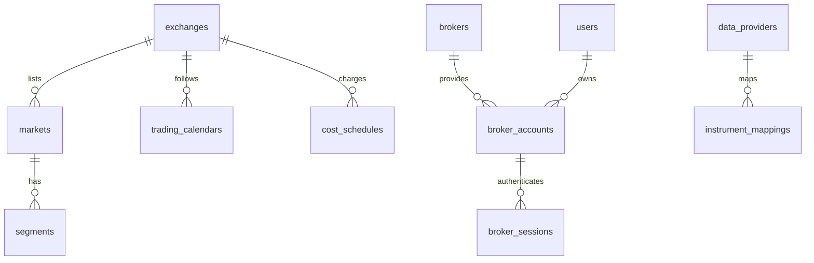
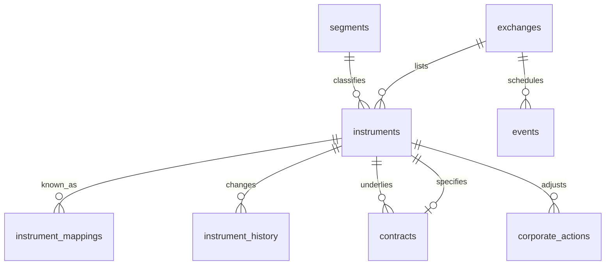
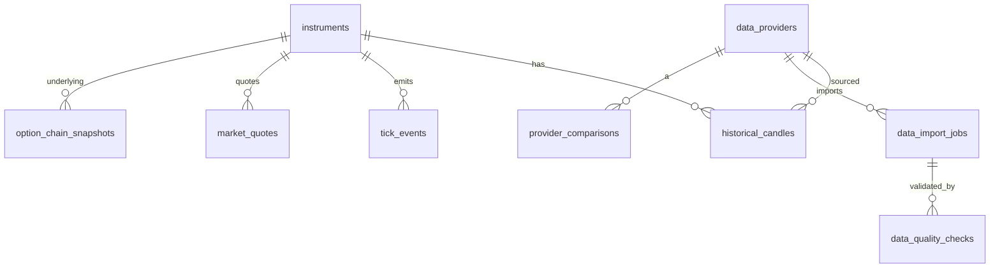
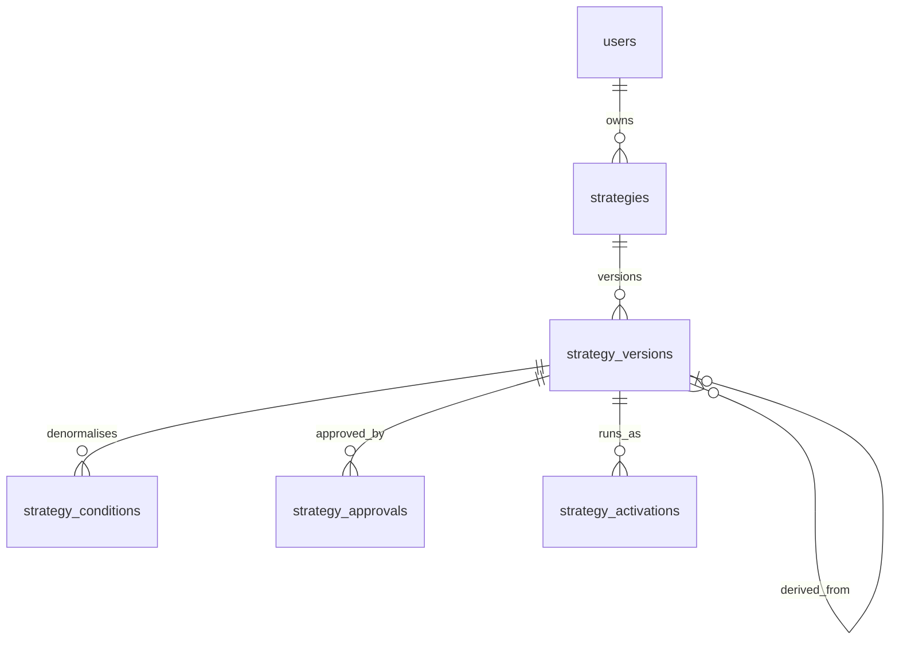
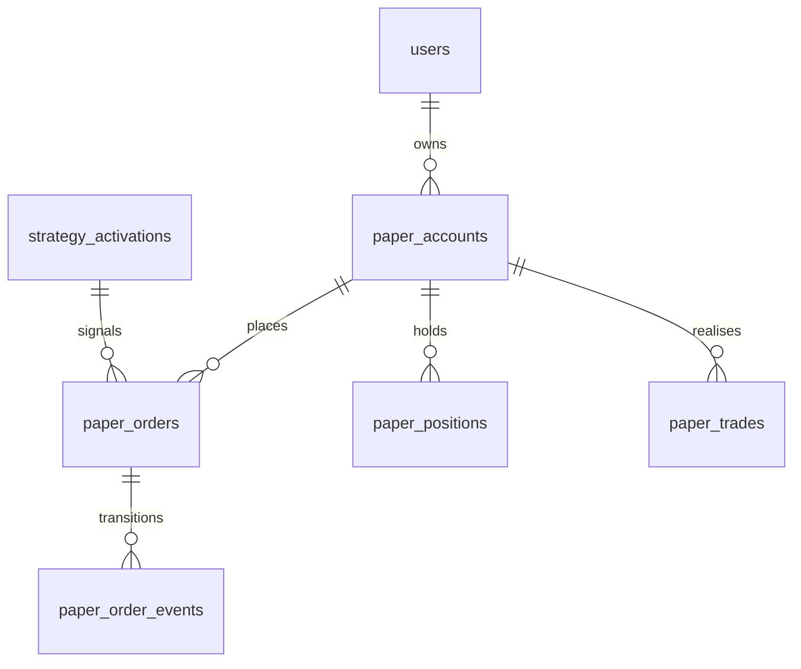
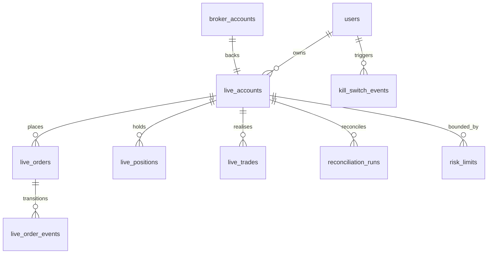
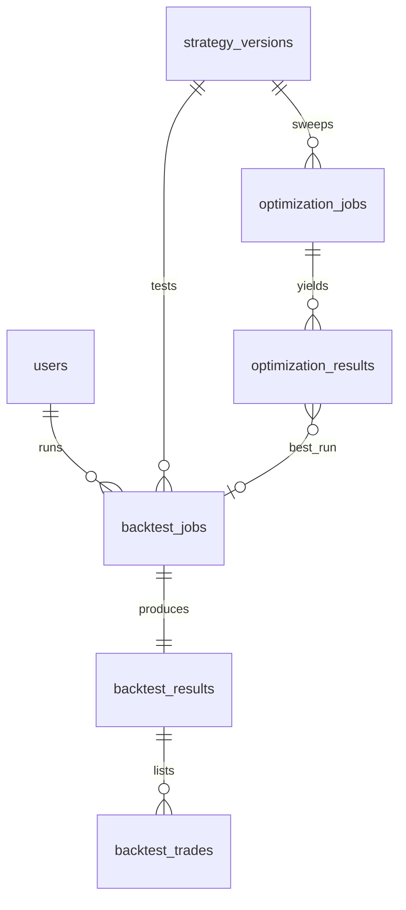
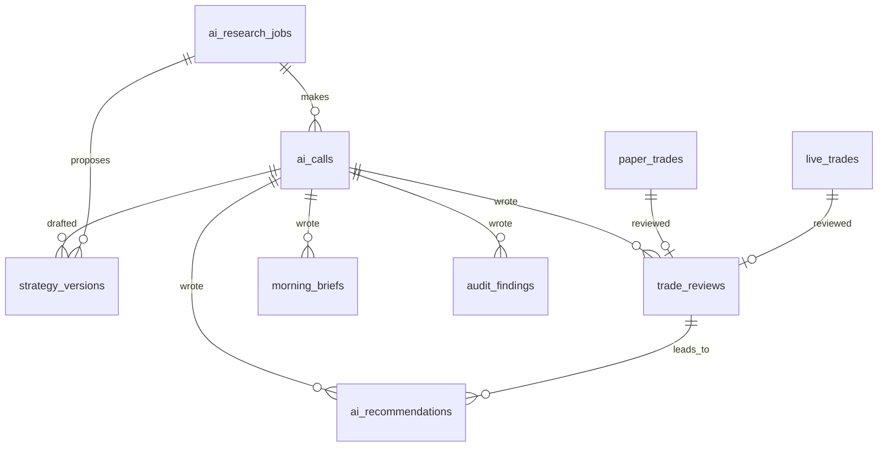
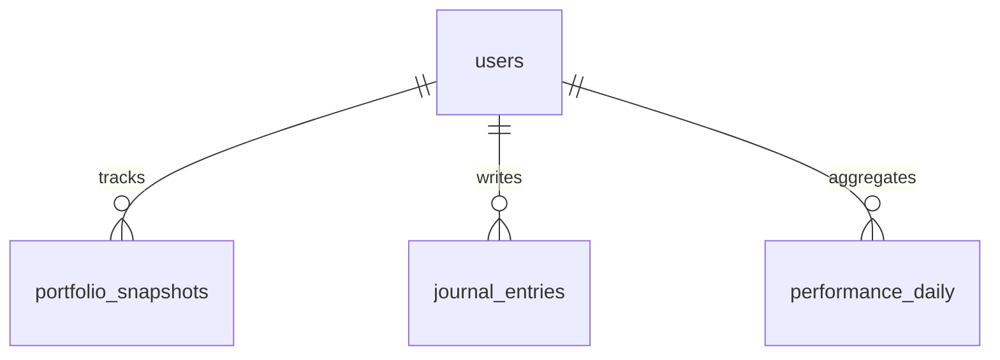

# 03 · Database Design

PostgreSQL 16 + TimescaleDB (ADR-004). This document is the design reference; the
authoritative schema is the Alembic migration chain in `infra/migrations`.

---

## 1. Design principles

| Principle | Rule | Why |
|-----------|------|-----|
| Time | Every time column is `timestamptz`, stored in UTC. Candle `ts` = bar **open** time. | ADR-006; no DST/IST ambiguity. |
| Provenance | Every market-data row carries `provider_id`, `provider_ts` (provider's own stamp) and `ingested_at` (our receive time). | Latency analysis, provider comparison (Module 15), auditability. |
| Raw vs derived | Raw tables (`historical_candles`, `tick_events`, `market_quotes`, `option_chain_snapshots`) are append-only. Derived data (adjusted prices, indicators, delta, 5-min bars built from 1-min) lives in separate tables/views and can always be rebuilt. | Master prompt §9; a bad derivation never corrupts the archive. |
| Ownership | Every user-owned entity has `user_id` and is filtered in the repository layer. | ADR-014, multi-user ready. |
| Status enums | Status columns are Postgres enums with explicit state machines (section 4). Transitions are enforced in code and recorded in `*_events` tables. | Full audit trail of every order and strategy. |
| Immutability | `strategy_versions` rows are frozen once status leaves `draft` (trigger raises on UPDATE of `dsl`). Approved versions are never edited. | ADR-009, master prompt Module 5. |
| Isolation | Paper and live have separate tables, accounts, services (ADR-008). | A bug in paper can never touch live money. |
| Identity | Instruments are identified internally by a surrogate `instrument_id`; the natural key is `(exchange_id, isin or exchange_token, contract spec)`. Provider symbols live only in `instrument_mappings`. | No provider lock-in. |
| Timescale | High-volume time-series tables are hypertables with compression and retention policies declared in the creating migration (section 5). | ADR-004. |
| Soft delete | None. Rows are retired via status; audit tables are never deleted. | Reproducibility. |
| Idempotency | Orders carry `idempotency_key` (unique). Jobs carry `job_key`. Imports carry `manifest_hash`. | ADR-007, master prompt §10. |

Common columns, not repeated below: `id uuid pk default gen_random_uuid()`, `created_at timestamptz not null default now()`, `updated_at timestamptz` (where mutable).

---

## 2. Entity groups

### 2a · Identity & access



**users**

| column | type | notes |
|--------|------|-------|
| email | citext | unique |
| password_hash | text | Argon2id |
| totp_secret_enc | bytea | nullable; encrypted with `SECRETS_KEY` |
| display_name | text | |
| locale | text | `mr`, `hi`, `en` |
| is_active | bool | default true |

**roles**

| column | type | notes |
|--------|------|-------|
| name | text | unique; seed `owner`, `trader`, `viewer` |
| permissions | jsonb | list of permission strings |

**user_roles** — `user_id fk`, `role_id fk`, PK (user_id, role_id).

**sessions**

| column | type | notes |
|--------|------|-------|
| user_id | fk users | idx |
| refresh_token_hash | text | unique |
| expires_at | timestamptz | idx |
| ip, user_agent | text | |
| revoked_at | timestamptz | nullable |

**audit_logs** (append-only)

| column | type | notes |
|--------|------|-------|
| user_id | fk users | nullable (system actions) |
| actor_type | enum | `user`, `system`, `ai`, `scheduler` |
| action | text | e.g. `strategy.approve`, `order.submit_refused` |
| entity_type, entity_id | text, uuid | idx (entity_type, entity_id) |
| before, after | jsonb | nullable |
| reason | text | |
| ts | timestamptz | idx desc |

**api_logs** (hypertable, 30-day retention)

| column | type | notes |
|--------|------|-------|
| ts | timestamptz | partition column |
| user_id | fk users | nullable |
| method, path, status | text, text, int | |
| latency_ms | int | |
| request_id | uuid | |

### 2b · Reference data



**exchanges**

| column | type | notes |
|--------|------|-------|
| code | text | unique; `NSE`, `BSE`, `MCX`, `NYSE`… |
| name | text | |
| timezone | text | IANA, e.g. `Asia/Kolkata` |
| currency | char(3) | ISO 4217 |
| country | char(2) | |
| session_rules | jsonb | default open/close, pre/post sessions, square-off time |

**markets** — `exchange_id fk`, `code` (`EQ`, `FO`, `CD`, `COM`), `name`; unique (exchange_id, code).

**segments** — `market_id fk`, `code` (`CASH`, `FUT`, `OPT`, `INDEX`), `settlement` (`T+1`, `cash`), unique (market_id, code).

**trading_calendars** (ADR-011)

| column | type | notes |
|--------|------|-------|
| exchange_id | fk | |
| date | date | PK (exchange_id, date) |
| session_type | enum | `normal`, `holiday`, `special`, `muhurat`, `half_day` |
| open_at, close_at | timestamptz | nullable for holiday |
| note, source | text | |

**cost_schedules** (ADR-011)

| column | type | notes |
|--------|------|-------|
| exchange_id | fk | |
| segment_id | fk | |
| product | enum | `intraday`, `delivery`, `futures`, `options` |
| charge_type | enum | `brokerage`, `stt`, `exchange_txn`, `sebi`, `stamp_duty`, `gst`, `clearing` |
| side | enum | `buy`, `sell`, `both` |
| rate_type | enum | `percent`, `flat_per_order`, `per_lot` |
| rate | numeric(12,8) | |
| cap | numeric(12,2) | nullable (e.g. ₹20 brokerage cap) |
| effective_from, effective_to | date | idx; no overlap per key (exclusion constraint) |
| source | text | circular / broker page URL |

**data_providers** — `code` unique (`upstox`, `dhan`, `csv_import`), `name`, `capabilities jsonb` (depth levels, historical range, tick support), `is_active`.

**brokers** — `code` unique, `name`, `supports_data`, `supports_trading`, `auth_type` (`oauth2`, `token`).

**broker_accounts**

| column | type | notes |
|--------|------|-------|
| user_id | fk | idx |
| broker_id | fk | |
| client_code | text | broker's account id |
| api_key_enc, api_secret_enc | bytea | encrypted at rest |
| label | text | |
| is_active | bool | |
| | | unique (user_id, broker_id, client_code) |

**broker_sessions** (ADR-012)

| column | type | notes |
|--------|------|-------|
| broker_account_id | fk | idx |
| access_token_enc | bytea | |
| issued_at, expires_at | timestamptz | idx expires_at |
| status | enum | `valid`, `expired`, `revoked` |
| last_checked_at | timestamptz | |

### 2c · Instruments



**instruments**

| column | type | notes |
|--------|------|-------|
| exchange_id | fk | |
| segment_id | fk | |
| symbol | text | canonical, e.g. `NIFTY`, `RELIANCE`, `NIFTY25NOV24500CE` |
| name | text | |
| isin | text | nullable; idx |
| exchange_token | text | nullable; idx |
| instrument_type | enum | `equity`, `index`, `future`, `option`, `etf`, `currency`, `commodity` |
| lot_size | int | current value; history in `instrument_history` |
| tick_size | numeric(12,4) | current |
| freeze_qty | int | nullable (F&O) |
| is_tradable | bool | |
| listed_at, delisted_at | date | survivorship-bias support |
| | | unique (exchange_id, symbol) |

**instrument_mappings**

| column | type | notes |
|--------|------|-------|
| instrument_id | fk | |
| provider_id | fk data_providers | |
| provider_symbol | text | |
| provider_token | text | provider's instrument key |
| valid_from, valid_to | date | provider keys change on roll |
| raw | jsonb | provider master row as received |
| | | unique (provider_id, provider_token, valid_from) |

**instrument_history** (point-in-time attributes)

| column | type | notes |
|--------|------|-------|
| instrument_id | fk | |
| attribute | enum | `lot_size`, `tick_size`, `symbol`, `freeze_qty`, `name` |
| old_value, new_value | text | |
| effective_from | date | idx (instrument_id, attribute, effective_from) |
| source | text | |

**contracts** (one row per F&O instrument)

| column | type | notes |
|--------|------|-------|
| instrument_id | fk | unique |
| underlying_id | fk instruments | idx |
| expiry | date | idx (underlying_id, expiry) |
| strike | numeric(14,2) | nullable for futures |
| option_type | enum | `CE`, `PE`, null |
| contract_type | enum | `future`, `option` |
| settlement | enum | `cash`, `physical` |
| multiplier | numeric | |

**corporate_actions** (ADR-011)

| column | type | notes |
|--------|------|-------|
| instrument_id | fk | idx (instrument_id, ex_date) |
| action_type | enum | `split`, `bonus`, `dividend`, `rights`, `merger`, `symbol_change`, `delisting` |
| ex_date | date | |
| record_date | date | nullable |
| ratio_from, ratio_to | int | for split/bonus |
| amount | numeric(14,4) | dividend/rights price |
| adjustment_factor | numeric(18,10) | computed |
| source, raw | text, jsonb | |

**events** (ADR-013 interim)

| column | type | notes |
|--------|------|-------|
| exchange_id | fk | nullable (global events) |
| event_type | enum | `rbi_policy`, `fed`, `budget`, `expiry`, `results`, `holiday_eve`, `macro`, `custom` |
| starts_at, ends_at | timestamptz | idx starts_at |
| instrument_id | fk | nullable (results) |
| impact | enum | `low`, `medium`, `high` |
| blocks_trading | bool | consumed by risk engine |
| title, source | text | |

### 2d · Market data



**historical_candles** (hypertable on `ts`, space partition `instrument_id`)

| column | type | notes |
|--------|------|-------|
| instrument_id | fk | |
| timeframe | enum | `1s`,`1m`,`5m`,`15m`,`30m`,`1h`,`1d`,`1w`,`1M` |
| ts | timestamptz | bar open, UTC |
| provider_id | fk | |
| open, high, low, close | numeric(14,4) | |
| volume | bigint | |
| oi | bigint | nullable |
| provider_ts | timestamptz | nullable |
| ingested_at | timestamptz | default now() |
| import_job_id | fk | nullable |
| | | **PK (instrument_id, timeframe, ts, provider_id)** |
| | | check high ≥ low, high ≥ open/close, low ≤ open/close |

Only `1m` and `1d` are ingested from providers/collector; `5m`…`1M` are materialised
continuous aggregates (`candles_5m` …) so they never disagree with their source.

**tick_events** (hypertable; written only when `COLLECT_RAW_TICKS=true`, ADR-010)

| column | type | notes |
|--------|------|-------|
| instrument_id | fk | |
| ts | timestamptz | our receive time |
| provider_id | fk | |
| provider_ts | timestamptz | exchange/feed timestamp |
| ltp | numeric(14,4) | |
| ltq | int | |
| volume | bigint | cumulative |
| oi | bigint | |
| bid_px, ask_px | numeric(14,4) | best |
| bid_qty, ask_qty | int | |
| depth | jsonb | nullable; up to 30 levels, compressed |
| seq | bigint | provider sequence if present |

**market_quotes** (hypertable; last-quote snapshots every N seconds for tracked instruments)

| column | type | notes |
|--------|------|-------|
| instrument_id, ts, provider_id | | PK |
| ltp, bid_px, ask_px, bid_qty, ask_qty | | |
| volume, oi | bigint | |
| provider_ts, ingested_at | timestamptz | |
| freshness | enum | `live`, `delayed`, `stale` |

**option_chain_snapshots** (hypertable, ADR-010)

| column | type | notes |
|--------|------|-------|
| underlying_id | fk instruments | |
| expiry | date | |
| strike | numeric(14,2) | |
| option_type | enum | CE/PE |
| ts | timestamptz | snapshot time (5-min grid) |
| provider_id | fk | |
| ltp, bid_px, ask_px | numeric | |
| volume, oi, oi_change | bigint | |
| iv | numeric(10,6) | provider or computed |
| delta, gamma, theta, vega | numeric(12,8) | computed, nullable |
| underlying_px | numeric(14,4) | spot at snapshot |
| | | PK (underlying_id, expiry, strike, option_type, ts, provider_id) |

**data_import_jobs**

| column | type | notes |
|--------|------|-------|
| user_id | fk | nullable (scheduled) |
| provider_id | fk | |
| source_type | enum | `api`, `csv`, `excel`, `json`, `parquet`, `collector` |
| source_uri | text | file path / API range |
| manifest_hash | text | unique; sha256 of file or request |
| instrument_scope | jsonb | |
| timeframe | enum | |
| range_from, range_to | timestamptz | |
| status | enum | `queued`, `running`, `succeeded`, `failed`, `partial` |
| rows_read, rows_written, rows_rejected | bigint | |
| error | text | |
| started_at, finished_at | timestamptz | |

**data_quality_checks**

| column | type | notes |
|--------|------|-------|
| import_job_id | fk | nullable (scheduled checks) |
| instrument_id | fk | |
| timeframe | enum | |
| check_type | enum | `missing_candles`, `duplicates`, `ohlc_invalid`, `volume_spike`, `gap_vs_prev_close`, `stale_feed` |
| range_from, range_to | timestamptz | |
| severity | enum | `info`, `warn`, `error` |
| details | jsonb | list of offending ts |
| resolved_at | timestamptz | nullable |

**provider_comparisons** (Module 15)

| column | type | notes |
|--------|------|-------|
| provider_a_id, provider_b_id | fk | |
| instrument_id | fk | |
| timeframe | enum | |
| ts | timestamptz | |
| metric | enum | `price_diff`, `ts_diff_ms`, `volume_diff`, `missing_a`, `missing_b`, `latency_ms` |
| value | numeric | |
| normalised | bool | timestamps/mapping normalised before compare |

### 2e · Strategy



**strategies**

| column | type | notes |
|--------|------|-------|
| user_id | fk | idx |
| name | text | unique per user |
| category | enum | `trend`, `mean_reversion`, `breakout`, `options`, `swing`, `other` |
| origin | enum | `user_nl`, `user_visual`, `ai_research`, `ai_learning`, `import` |
| description | text | |
| tags | text[] | |
| is_archived | bool | |

**strategy_versions** (immutable after `draft`)

| column | type | notes |
|--------|------|-------|
| strategy_id | fk | |
| version_no | int | unique (strategy_id, version_no) |
| parent_version_id | fk self | nullable; lineage for AI-proposed changes |
| status | enum | see §4 |
| dsl | jsonb | validated against `dsl_schema_version` |
| dsl_schema_version | text | e.g. `1.0` |
| dsl_hash | text | sha256; unique per strategy (no duplicate versions) |
| source_text | text | original NL description, if any |
| source_language | text | `mr`, `hi`, `en` |
| created_by | enum | `user`, `ai` |
| ai_call_id | fk ai_calls | nullable; traceability |
| change_summary | text | |
| frozen_at | timestamptz | set when leaving draft |

Trigger: `BEFORE UPDATE` raises if `OLD.status <> 'draft'` and `NEW.dsl <> OLD.dsl`.

**strategy_conditions** (optional denormalisation for library search; rebuilt from `dsl`)

| column | type | notes |
|--------|------|-------|
| version_id | fk | |
| role | enum | `entry`, `exit`, `stop`, `target`, `filter` |
| indicator | text | |
| params | jsonb | |
| operator | text | |
| ordinal | int | |

**strategy_approvals**

| column | type | notes |
|--------|------|-------|
| version_id | fk | |
| user_id | fk | approver |
| from_status, to_status | enum | |
| evidence | jsonb | backtest_result_ids, paper period, metrics |
| decision | enum | `approved`, `rejected` |
| note | text | |
| ts | timestamptz | |

**strategy_activations**

| column | type | notes |
|--------|------|-------|
| version_id | fk | |
| trading_mode | enum | `paper`, `live` |
| paper_account_id | fk | nullable; exactly one of the two account fks set (check) |
| live_account_id | fk | nullable |
| instrument_id | fk | |
| params_override | jsonb | capital, qty, allowed session window |
| status | enum | `active`, `paused`, `stopped` |
| activated_by | fk users | required for live (check) |
| activated_at, stopped_at | timestamptz | |
| stop_reason | text | |

### 2f · Paper trading



**paper_accounts**

| column | type | notes |
|--------|------|-------|
| user_id | fk | |
| name | text | |
| currency | char(3) | |
| initial_capital | numeric(18,2) | default 100000 |
| cash_balance | numeric(18,2) | |
| realized_pnl | numeric(18,2) | |
| cost_profile | jsonb | brokerage plan, slippage model params |
| reset_at | timestamptz | nullable |

**paper_orders**

| column | type | notes |
|--------|------|-------|
| paper_account_id | fk | idx |
| activation_id | fk | nullable (manual) |
| signal_id | uuid | from strategy engine |
| idempotency_key | text | unique |
| instrument_id | fk | |
| side | enum | `buy`, `sell` |
| order_type | enum | `market`, `limit`, `sl`, `sl_m` |
| product | enum | `intraday`, `delivery`, `normal` |
| qty, filled_qty | int | |
| limit_px, trigger_px | numeric | nullable |
| avg_fill_px | numeric | nullable |
| status | enum | see §4 |
| parent_order_id | fk self | bracket legs |
| placed_at, last_update_at | timestamptz | |
| bid_at_place, ask_at_place | numeric | ADR-010 |
| sim_slippage, sim_costs | numeric | breakdown in `cost_breakdown jsonb` |

**paper_order_events** — `order_id fk`, `from_status`, `to_status`, `fill_qty`, `fill_px`, `reason`, `ts`; append-only.

**paper_positions**

| column | type | notes |
|--------|------|-------|
| paper_account_id, instrument_id, product | | unique while open |
| qty | int | signed |
| avg_px | numeric | |
| realized_pnl, unrealized_pnl | numeric | |
| opened_at, closed_at | timestamptz | |
| activation_id | fk | |

**paper_trades** (round-trips)

| column | type | notes |
|--------|------|-------|
| paper_account_id, activation_id, instrument_id | fk | |
| version_id | fk strategy_versions | |
| entry_order_id, exit_order_id | fk | |
| side, qty | | |
| entry_px, exit_px | numeric | |
| entry_at, exit_at | timestamptz | |
| gross_pnl, costs, net_pnl | numeric | |
| mae, mfe | numeric | max adverse/favourable excursion |
| regime_snapshot | jsonb | regime at entry |
| entry_reason, exit_reason | text | from engine |

### 2g · Live trading



**live_accounts** — `user_id fk`, `broker_account_id fk unique`, `name`, `currency`, `is_enabled` (default false; must be explicitly enabled), `enabled_by fk users`, `enabled_at`.

**live_orders** — same columns as `paper_orders` plus:

| column | type | notes |
|--------|------|-------|
| broker_order_id | text | unique (live_account_id, broker_order_id) |
| broker_status_raw | text | last raw status |
| gate_results | jsonb | the five ADR-007 gate outcomes at submit |
| submitted_at, broker_ack_at | timestamptz | |
| last_reconciled_at | timestamptz | |

**live_order_events** — as paper, plus `source enum (broker_callback, reconciliation, user, gateway)`. Status never changes from any other source.

**live_positions** — as paper, plus `broker_qty`, `broker_avg_px`, `mismatch bool`.

**live_trades** — as paper_trades.

**reconciliation_runs**

| column | type | notes |
|--------|------|-------|
| live_account_id | fk | |
| ts | timestamptz | |
| orders_checked, orders_mismatched | int | |
| positions_checked, positions_mismatched | int | |
| details | jsonb | |
| action_taken | enum | `none`, `alert`, `kill_switch` |

**kill_switch_events**

| column | type | notes |
|--------|------|-------|
| scope | enum | `global`, `account`, `strategy` |
| scope_id | uuid | nullable for global |
| state | enum | `on`, `off` |
| triggered_by | enum | `user`, `monitor_rule`, `risk_engine` |
| user_id | fk | nullable |
| rule | text | which deterministic rule fired |
| ts | timestamptz | idx desc |
| positions_flattened | bool | |

**risk_limits**

| column | type | notes |
|--------|------|-------|
| scope | enum | `account`, `strategy_activation` |
| scope_id | uuid | |
| trading_mode | enum | paper/live |
| max_risk_per_trade_pct | numeric | |
| max_daily_loss_pct, max_weekly_loss_pct | numeric | |
| max_drawdown_pct | numeric | |
| max_open_positions | int | |
| max_exposure | numeric | |
| max_correlated_positions | int | |
| no_new_entries_after | time | exchange-local |
| square_off_at | time | exchange-local |
| block_on_events | bool | |
| effective_from | timestamptz | changes are new rows, old rows kept |
| set_by | fk users | |

### 2h · Backtesting



**backtest_jobs**

| column | type | notes |
|--------|------|-------|
| user_id | fk | |
| version_id | fk | |
| job_key | text | unique; hash of (version, config) → cached reuse |
| config | jsonb | instruments, timeframe, range, capital, cost profile, slippage model, seed, data snapshot id |
| data_snapshot | jsonb | provider_id + max `ingested_at` used (point-in-time reproducibility) |
| status | enum | `queued`, `running`, `succeeded`, `failed`, `cancelled` |
| progress_pct | int | |
| engine_version | text | git sha of engine |
| started_at, finished_at | timestamptz | |
| error | text | |

**backtest_results**

| column | type | notes |
|--------|------|-------|
| job_id | fk | unique |
| total_return, cagr | numeric | |
| total_trades, win_rate | int, numeric | |
| profit_factor, expectancy | numeric | |
| max_drawdown, max_dd_duration_days | numeric, int | |
| sharpe, sortino, calmar | numeric | |
| avg_win, avg_loss, max_consec_losses | numeric, numeric, int | |
| exposure_pct | numeric | |
| total_costs | numeric | |
| equity_curve | jsonb or Parquet URI | daily points |
| drawdown_curve | jsonb or Parquet URI | |
| monthly_returns | jsonb | |
| is_out_of_sample | bool | |

**backtest_trades** — like paper_trades with `result_id fk`, `bar_index_entry/exit`; bulk rows, index (result_id, entry_at).

**optimization_jobs**

| column | type | notes |
|--------|------|-------|
| version_id, user_id | fk | |
| method | enum | `grid`, `random`, `walk_forward`, `sensitivity` |
| param_space | jsonb | |
| objective | text | e.g. `sharpe`, `expectancy` |
| folds | jsonb | walk-forward windows |
| status | enum | |
| overfit_score | numeric | e.g. deflated Sharpe / PBO |

**optimization_results** — `job_id fk`, `params jsonb`, `in_sample jsonb`, `out_of_sample jsonb`, `rank int`, `backtest_job_id fk nullable`.

### 2i · AI



**ai_calls** (ADR-009; append-only)

| column | type | notes |
|--------|------|-------|
| agent | enum | `translator`, `analyst`, `researcher`, `reviewer`, `risk_reviewer`, `monitor_explainer`, `auditor` |
| provider | text | `openai`, `anthropic`, `google`, `local` |
| model | text | |
| prompt_version | text | |
| schema_name, schema_version | text | |
| input_refs | jsonb | ids of trades/candles/versions supplied |
| input_tokens, output_tokens | int | |
| cost_usd | numeric(10,6) | |
| latency_ms | int | |
| validated | bool | Pydantic validation outcome |
| error | text | |
| job_id | uuid | nullable; research/review job |
| ts | timestamptz | idx |

Prompts and raw responses are stored in MinIO under `ai-calls/<id>/`, referenced by `payload_uri`.

**ai_research_jobs**

| column | type | notes |
|--------|------|-------|
| user_id | fk | |
| kind | enum | `hypothesis_generation`, `parameter_exploration`, `learning_followup`, `regime_study` |
| hypothesis | text | written before testing |
| scope | jsonb | instruments, range, constraints |
| token_budget, tokens_used | int | hard stop |
| status | enum | |
| report | text | markdown |
| proposed_version_ids | uuid[] | all `draft` |
| started_at, finished_at | timestamptz | |

**ai_recommendations**

| column | type | notes |
|--------|------|-------|
| kind | enum | `strategy_change`, `risk_limit_change`, `retire_strategy`, `data_quality`, `routine` |
| target_type, target_id | text, uuid | |
| summary, rationale | text | |
| evidence | jsonb | backtest/trade ids, metrics before/after |
| proposed_version_id | fk | nullable; the new draft |
| status | enum | `open`, `accepted`, `rejected`, `superseded` |
| decided_by | fk users | nullable |
| decided_at | timestamptz | |
| ai_call_id | fk | |

**trade_reviews**

| column | type | notes |
|--------|------|-------|
| trading_mode | enum | |
| trade_id | uuid | paper or live trade (check with mode) |
| rule_compliant | bool | |
| entry_quality, exit_quality | smallint | 1–5 |
| slippage_assessment | text | |
| regime_fit | text | |
| patterns | text[] | matched against prior reviews |
| findings | jsonb | structured |
| hypothesis | text | nullable → research job |
| user_notes | text | the three daily questions |
| ai_call_id | fk | |

**morning_briefs**

| column | type | notes |
|--------|------|-------|
| exchange_id | fk | |
| date | date | unique (exchange_id, date) |
| regime | jsonb | detector output (deterministic) |
| ai_view | jsonb | analyst output; shown beside, never overrides |
| levels | jsonb | |
| events | uuid[] | |
| strategy_recommendations | jsonb | enable/disable suggestions |
| ai_call_id | fk | |

**audit_findings** — `date`, `scope enum (research, reviews, risk, data)`, `severity`, `finding text`, `evidence jsonb`, `ai_call_id fk`, `acknowledged_by fk users`, `acknowledged_at`.

### 2j · Portfolio & journal



**portfolio_snapshots** (hypertable, daily + intraday)

| column | type | notes |
|--------|------|-------|
| user_id | fk | |
| trading_mode | enum | |
| account_id | uuid | paper or live |
| ts | timestamptz | |
| cash, margin_used, margin_available | numeric | |
| exposure_gross, exposure_net | numeric | |
| unrealized_pnl, realized_pnl_day | numeric | |
| equity | numeric | |
| positions | jsonb | |

**journal_entries**

| column | type | notes |
|--------|------|-------|
| user_id | fk | |
| date | date | idx |
| kind | enum | `daily_review`, `trade_note`, `rule_violation`, `idea`, `weekly_review`, `monthly_review`, `state_check` |
| trade_ref | jsonb | mode + id, nullable |
| mood_score | smallint | 1–5, for `state_check` |
| sleep_hours | numeric(3,1) | nullable |
| body | text | |
| tags | text[] | |

**performance_daily**

| column | type | notes |
|--------|------|-------|
| user_id | fk | |
| date | date | |
| trading_mode | enum | |
| scope | enum | `account`, `strategy_version`, `instrument` |
| scope_id | uuid | |
| trades, wins, losses | int | |
| gross_pnl, costs, net_pnl | numeric | |
| max_dd_intraday | numeric | |
| rule_violations | int | |
| | | PK (user_id, date, trading_mode, scope, scope_id) |

---

## 3. Cross-cutting views

| View | Purpose |
|------|---------|
| `candles_adjusted` | `historical_candles` × `corporate_actions` adjustment factor; never stored. |
| `candles_5m/15m/30m/1h` | Timescale continuous aggregates from `1m`. |
| `trades_all` | UNION of paper_trades and live_trades with `trading_mode`; read-only for analytics. |
| `orders_all` | Same for orders. |
| `instrument_pit(date)` | Function returning lot/tick size as of a date. |
| `cost_rate(exchange, segment, product, charge, side, date)` | Function used by the simulator. |

---

## 4. Enums and state machines

**order_status**

```
created → validated → submitted → acknowledged → partially_filled → filled
                 ↘ rejected       ↘ cancelled    ↘ cancelled        
submitted/acknowledged → expired
```

Terminal: `filled`, `cancelled`, `rejected`, `expired`. Paper and live share the enum; live
transitions only via `broker_callback` or `reconciliation` (ADR-007).

**strategy_version_status**

```
draft → backtested → validated → paper → approved_live → retired
  ↘ rejected (from any non-terminal state)
```

- `backtested`: at least one `backtest_results` row, in-sample.
- `validated`: out-of-sample / walk-forward passed thresholds in `strategy_approvals.evidence`.
- `paper`: activation in paper mode for the configured minimum period.
- `approved_live`: `strategy_approvals` row by a user with `trader`/`owner` role.
- Only `draft` is mutable. AI may create `draft` only.

**trading_mode:** `paper`, `live`.
**activation_status:** `active`, `paused`, `stopped`.
**freshness:** `live`, `delayed`, `stale`, `disconnected`, `demo`.
**session_type:** `normal`, `holiday`, `special`, `muhurat`, `half_day`.
**timeframe:** `1s`, `1m`, `5m`, `15m`, `30m`, `1h`, `1d`, `1w`, `1M`.
**job_status:** `queued`, `running`, `succeeded`, `failed`, `cancelled`, `partial`.
**actor_type:** `user`, `system`, `ai`, `scheduler`.
**kill_switch_scope:** `global`, `account`, `strategy`.
**regime (jsonb values):** trend ∈ {`up`, `down`, `sideways`}, volatility ∈ {`low`, `normal`, `high`}, breadth ∈ {`weak`, `neutral`, `strong`}.

---

## 5. Hypertables, compression, retention

| Table | Chunk interval | Space partition | Compress after | Segment by | Retention |
|-------|---------------|-----------------|----------------|------------|-----------|
| historical_candles | 1 month (`1m`), 1 year (`1d`) | instrument_id | 7 days | instrument_id, timeframe, provider_id | none |
| tick_events | 1 day | instrument_id | 1 day | instrument_id | 90 days in DB, then Parquet archive (Phase 8) |
| market_quotes | 1 day | — | 1 day | instrument_id | 30 days |
| option_chain_snapshots | 1 week | underlying_id | 7 days | underlying_id, expiry | none |
| portfolio_snapshots | 1 month | — | 30 days | user_id | none |
| api_logs | 1 day | — | 1 day | — | 30 days |

Continuous aggregates `candles_5m … candles_1h` refresh every minute during session hours.
All policies are created in the same migration as the table.

---

## 6. Migration plan

| Phase | Migration group | Tables |
|-------|-----------------|--------|
| 1 | `0001_identity` | users, roles, user_roles, sessions, audit_logs, api_logs |
| 1 | `0002_reference` | exchanges, markets, segments, trading_calendars, data_providers, brokers, cost_schedules (+ NSE seed) |
| 1 | `0003_instruments` | instruments, instrument_mappings, instrument_history, contracts, corporate_actions, events |
| 1 | `0004_strategy_core` | strategies, strategy_versions (+ immutability trigger), strategy_conditions, strategy_approvals |
| 1 | `0005_market_data_core` | historical_candles (hypertable + aggregates), data_import_jobs, data_quality_checks |
| 2 | `0006_broker_sessions` | broker_accounts, broker_sessions |
| 2 | `0007_live_feed` | market_quotes, option_chain_snapshots, tick_events (flag), provider_comparisons |
| 3 | `0008_paper` | paper_accounts, paper_orders, paper_order_events, paper_positions, paper_trades, strategy_activations, risk_limits |
| 3 | `0009_live` | live_accounts, live_orders, live_order_events, live_positions, live_trades, reconciliation_runs, kill_switch_events |
| 3 | `0010_portfolio` | portfolio_snapshots, performance_daily, journal_entries |
| 4 | `0011_backtest` | backtest_jobs, backtest_results, backtest_trades, optimization_jobs, optimization_results |
| 5–6 | `0012_ai` | ai_calls, ai_research_jobs, ai_recommendations, trade_reviews, morning_briefs, audit_findings |

Every migration is reversible, has a test that applies it to an empty database and to the
previous head, and seeds only reference data (never user or market data).
