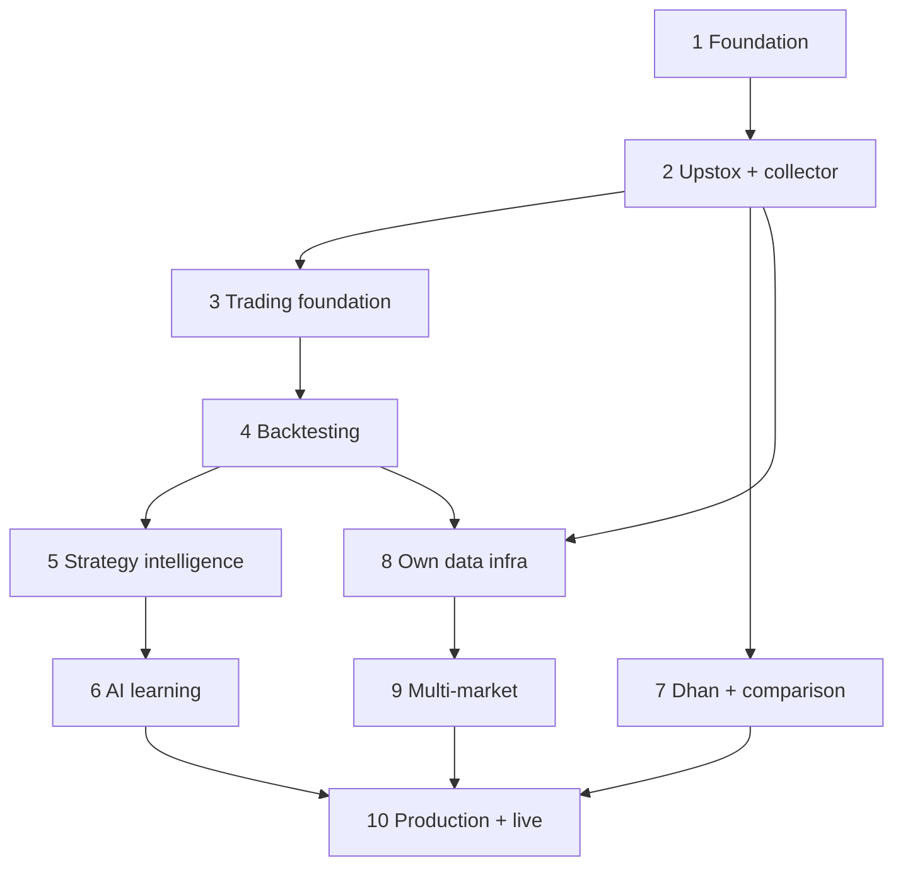

# 07 · Implementation Roadmap

The ten phases from `docs/MASTER_PROMPT.md` §11, adjusted by the ADRs. The rule that governs
every phase: **the application must work at the end of the phase**. Each phase lists the
exit criteria that define "works".

Effort figures assume one developer working with AI assistance, roughly 25–30 focused hours
a week, and include tests and documentation. They are estimates, not commitments.

---

## 0. Summary

| Phase | Name | Weeks | Cumulative | Depends on |
|-------|------|-------|------------|------------|
| 1 | Foundation | 3 | 3 | — |
| 2 | Upstox integration + collector | 4 | 7 | 1 |
| 3 | Trading foundation (engine, OMS, risk, paper) | 5 | 12 | 2 |
| 4 | Backtesting, replay, optimisation | 6 | 18 | 3 |
| 5 | Strategy intelligence (NL, visual, library, AI generation) | 6 | 24 | 4 |
| 6 | AI learning and research | 4 | 28 | 5 |
| 7 | Second provider (Dhan), comparison, failover | 3 | 31 | 2 (parallel-able from 3) |
| 8 | Independent data infrastructure | 4 | 35 | 2, 4 |
| 9 | Multi-market adapters | 4 | 39 | 8 |
| 10 | Production hardening and live validation | 4 | 43 | all |

About ten months of calendar time at this pace. Phases 7 and 8 can overlap with 5–6 if
time allows, since they touch different packages.

### Dependency graph

### ADR adjustments applied to the master roadmap

| Adjustment | Where | ADR |
|------------|-------|-----|
| TimescaleDB hypertables from the first migration | Phase 1 (was Phase 8) | ADR-004 |
| Market data collector (1-min candles, option-chain snapshots, VIX) runs from the first day Upstox is connected | Phase 2 | ADR-010 |
| Telegram notifications and daily broker-login workflow | Phase 2 (not a later nicety) | ADR-012 |
| Python Strategy Editor removed from v1 | Phase 5 scope | ADR-003 |
| News and sentiment deferred until a licensed source is chosen; `events` table instead | After Phase 6 | ADR-013 |
| Raw tick/depth archive behind `COLLECT_RAW_TICKS` flag, off by default | Phase 2 code, Phase 8 default decision | ADR-010 |
| Corporate actions, trading calendars, cost schedules as first-class tables | Phase 1 schema, Phase 2 data | ADR-011 |
| Live order gateway code lands early behind a flag; live UI enabled only in Phase 10 | Phase 3 / Phase 10 | ADR-007 |

---

## Phase 1 — Foundation (3 weeks)

**Goal:** A running, authenticated, empty platform with the database, job system, provider
interface and design system in place, so every later phase only adds modules.

**Deliverables**
- [ ] Monorepo scaffold per `02-folder-structure.md`, uv workspace, pnpm workspace
- [ ] `docker compose up` brings up Postgres+TimescaleDB, Redis, MinIO, api, worker, web
- [ ] FastAPI app: `/health`, `/version`, auth routes, OpenAPI document
- [ ] Alembic with first migrations: users/roles, exchanges (NSE seeded), markets, instruments,
      instrument_mappings, instrument_history, data_providers, brokers, broker_accounts,
      broker_sessions, trading_calendars, corporate_actions, cost_schedules, audit_logs, and the
      hypertables `historical_candles`, `market_quotes`, `option_chain_snapshots`, `tick_events`
      with compression and retention policies
- [ ] `packages/core`: canonical models (Instrument, Candle, Quote, Depth, OptionChainRow),
      time utilities, trading calendar logic for NSE, settings loader, structured logging
- [ ] `packages/market_data`: `MarketDataProvider` interface, `ProviderManager` with single
      mode, `FakeProvider` clearly labelled demo, provider health model
- [ ] `apps/worker`: arq worker skeleton, one scheduled job (calendar refresh), job registry
- [ ] Auth: Argon2 passwords, JWT access + rotating refresh, optional TOTP, roles, CLI `create-owner`
- [ ] Secrets: `SECRETS_KEY` encryption helper for broker credentials, `.env.example` documented
- [ ] Next.js shell as defined in `06-ui-page-map.md` §4 (layout, sidebar, auth, dashboard
      with real status panels and explicit Disconnected tiles, settings skeleton, NSE card)
- [ ] Generated TypeScript API client (`pnpm gen:api`)
- [ ] CI: ruff, mypy, pytest, import-boundary check, Alembic head check, web lint + type-check + build
- [ ] `docs/progress.md` created; `.env.example`; README quickstart

**Tests required**
- Unit: calendar (holidays, sessions, UTC↔IST), canonical model validation, auth token
  rotation, secrets round-trip
- Integration: migrations apply from empty DB and are reversible one step; `/health` and
  auth flow against a real Postgres in CI
- Web: Playwright smoke (login, every sidebar route renders, dashboard shows Disconnected)

**Exit criteria**
- A fresh clone runs `docker compose up`, `uv run alembic upgrade head`, `uv run app create-owner`,
  and the owner can log in and see the dashboard with every tile in an explicit non-fake state.
- CI is green on main.

---

## Phase 2 — Upstox integration and market data collector (4 weeks)

**Goal:** Real NSE market data flowing in, stored, and visible; the collector starts
accumulating the data that cannot be bought later.

**Deliverables**
- [ ] `packages/providers/upstox`: OAuth flow, token storage (encrypted), instrument master
      download and mapping into canonical instruments, historical candles API (all supported
      timeframes), live WebSocket (protobuf decode), option chain, rate-limit manager, reconnect
- [ ] Daily login workflow: 08:15 IST token check job, Telegram + in-app notification with
      login link, session status pill (ADR-012)
- [ ] `apps/collector` extracted from worker: subscribes to tracked instrument groups, builds
      1-min candles, stores option-chain snapshots every 5 min, VIX 1-min; `COLLECT_RAW_TICKS`
      flag implemented (off) writing Parquet partitions when on
- [ ] Historical backfill jobs: daily from 2010 where available, intraday as deep as Upstox
      allows, with coverage recorded per instrument × timeframe
- [ ] Data quality: missing-candle detection, duplicate detection, gap report per day
- [ ] Import tool: CSV/Excel/JSON/Parquet → `data_import_jobs` with validation report
- [ ] NSE bhavcopy, holidays, corporate actions, lot-size history nightly import (ADR-011)
- [ ] Redis quote cache and `/ws` quote channels
- [ ] UI: `/market` watchlist + chart + depth, `/market/option-chain`, `/market/providers`
      (Upstox card, coverage matrix), `/settings/brokers`, `/settings/providers`,
      `/settings/notifications`, `/tools` import; dashboard index strip goes Live

**Tests required**
- Unit: Upstox payload → canonical mapping with recorded fixtures; candle builder from ticks
  (boundary cases, late ticks, session edges); gap detector
- Integration: WebSocket client against a recorded replay server; backfill job writes
  hypertable rows idempotently
- Contract: provider interface compliance suite run against both Fake and Upstox adapters

**Exit criteria**
- During market hours the dashboard and `/market` show Live-badged NIFTY/BANKNIFTY quotes;
  after hours they show Delayed/Closed with the last session's data.
- Collector has run unattended on the VPS for five consecutive sessions with gap reports.
- An expired token produces a Disconnected state and a Telegram alert, never stale "live" data.

---

## Phase 3 — Trading foundation (5 weeks)

**Goal:** Strategies (seeded, DSL-defined) run in real time on live data against virtual
capital with realistic fills, inside hard risk limits.

**Deliverables**
- [ ] `packages/strategy/dsl`: Pydantic models + JSON Schema for the full DSL (ADR-003);
      `packages/strategy/indicators`: EMA, SMA, RSI, ATR, VWAP, Supertrend, Bollinger, ADX,
      OI-based helpers, in Polars with TA-Lib parity tests
- [ ] `packages/strategy/engine`: event-driven evaluator over canonical events, signal model,
      regime filter hook, session rules (no new entries after cutoff, square-off time)
- [ ] `packages/execution/orders`: order state machine with `order_events`, idempotency keys
- [ ] `packages/execution/simulator`: market/limit/stop/target, partial fills, bid/ask-based
      fills, slippage model, Indian cost model from `cost_schedules`, deterministic by seed
- [ ] `packages/risk`: position sizing, per-trade risk, daily/weekly loss, drawdown, exposure,
      correlation, event block, session window, freeze quantity; `ALLOW/REJECT` with reasons
- [ ] `packages/execution/live/gateway.py` with the five gates (ADR-007) behind
      `LIVE_TRADING_ENABLED=false`; broker order client for Upstox implemented but unreachable
      from any other module (import test)
- [ ] Paper trading service: accounts, orders, positions, trades, realized/unrealized P&L,
      strategy activations bound to paper mode (ADR-008)
- [ ] Kill switch: Redis flag + DB record, global/account/strategy, deterministic monitor rules
- [ ] Journal: every closed trade creates a journal row with strategy version, regime, reasons
- [ ] `events` table and admin import for RBI/Fed/budget/expiry (ADR-013)
- [ ] UI: `/trading`, `/paper/*`, `/portfolio` (paper), `/reports` journal, `/settings/risk`
      with market-hours edit lock; dashboard risk gauge, active strategies, running trades

**Tests required**
- Property-based (hypothesis): order state machine never reaches an invalid transition;
  positions never go negative on long-only strategies; realized + unrealized P&L equals
  cash delta; risk engine never ALLOWs a size exceeding limits
- Unit: cost model against hand-computed contract notes for equity intraday, delivery,
  futures, options on at least three historical dates
- Integration: a seeded EMA-cross strategy run on a recorded session produces identical
  fills across two runs with the same seed

**Exit criteria**
- A seeded strategy paper-trades a full live session end to end; fills show bid/ask at fill
  and charges; the daily loss limit, when hit on purpose with a tiny limit, stops the engine
  and the UI shows why.
- The gateway import-boundary test proves no path to broker order APIs outside the gateway.

---

## Phase 4 — Backtesting and research (6 weeks)

**Goal:** The same engine and simulator run over history, reproducibly, with honest costs and
bias controls; results are inspectable and comparable.

**Deliverables**
- [ ] `packages/backtest`: historical event source (DB/Parquet), point-in-time instrument
      master and lot sizes, adjusted prices as a derived view from corporate actions,
      execution delay, warm-up handling, no look-ahead by construction (events delivered
      strictly in time order, indicators computed incrementally)
- [ ] Metrics: total return, CAGR, win rate, profit factor, max DD, Sharpe, Sortino, Calmar,
      expectancy, avg win/loss, total trades, exposure time, per-trade MAE/MFE, equity curve
- [ ] Backtest jobs via arq with streamed progress; frozen assumptions stored with results
- [ ] Walk-forward and out-of-sample splits; parameter sweeps; sensitivity analysis;
      overfitting indicators (parameter-neighbourhood stability, deflated Sharpe lite)
- [ ] Strategy comparison engine on identical data and costs (Module 24)
- [ ] Replay engine: server-driven clock, play/pause/speed/step, strategy overlay
- [ ] Regime detector (deterministic): trend/range via ADX and structure, volatility via
      VIX/ATR percentiles, direction via daily structure; stored per day and intraday
- [ ] Options backtesting on stored chain snapshots and Upstox expired-instrument data where
      available; Greeks via Black-Scholes when provider values are missing
- [ ] UI: `/backtesting/*`, `/replay`, `/strategies/compare`, `/tools` cost and Greeks calculators;
      dashboard regime tile

**Tests required**
- Golden tests: a tiny hand-built dataset where every fill and metric is computed by hand
- Determinism: same inputs + seed → byte-identical results
- Bias tests: a strategy that peeks at the next candle must fail to compile/run
- Cross-check: backtest P&L for a session vs paper P&L of the same strategy on the same
  recorded session within a documented tolerance

**Exit criteria**
- Running the seeded strategy over three years finishes in minutes, is reproducible, and
  its results page shows metrics, equity, trades, assumptions, and walk-forward windows.
- The paper-vs-backtest cross-check report exists and is reviewed.

---

## Phase 5 — Strategy intelligence (6 weeks)

**Goal:** Users create strategies in Marathi, Hindi or English, or visually; AI proposes
strategies; all of it is the same DSL, versioned and governed by approvals.

**Deliverables**
- [ ] `packages/ai/llm`: `LLMProvider` interface, OpenAI adapter with structured outputs,
      `ai_calls` logging (model, prompt version, tokens, cost, input ids), per-job budgets (ADR-009)
- [ ] Natural Language Strategy Builder service: `POST /strategies/generate`, clarification
      thread, missing-information detection, DSL validation, original-text pinning, no silent
      condition changes (diffs surfaced)
- [ ] Evaluation set: ≥100 Marathi/Hindi/English descriptions with expected DSL; accuracy
      gate in CI (threshold documented in `docs/progress.md`)
- [ ] Visual builder producing the same DSL; scanner using DSL conditions over a universe
- [ ] Strategy library, versions, cloning, diff, categories, activation status
- [ ] Approval workflow: draft → backtested → OOS validated → paper (≥ N sessions) →
      approved_paper; `approved_live` state exists but activation is blocked until Phase 10
- [ ] AI autonomous generation (Mode A): hypothesis → DSL candidate → backtest job → report,
      candidates always `draft`, never activated by AI
- [ ] Python editor **not** built (ADR-003); placeholder page explains why and links to DSL docs
- [ ] UI: `/strategies/*` (library, NL builder, visual builder, detail, versions, approvals),
      `/scanner`, `/settings/ai`

**Tests required**
- Unit: DSL schema round-trips; validator catches unknown indicators, missing exits,
  contradictory conditions
- Evaluation: NL builder accuracy on the fixed set, run per prompt-version change
- Integration: approval state machine transitions only with required evidence rows present
- Security: attempts to submit executable code in any field are rejected and audited

**Exit criteria**
- The master prompt's Marathi example produces the expected DSL with `missing_information`
  listing exit and position sizing, asks clarifying questions, and saves a draft after the
  user answers.
- An AI-generated candidate appears with linked backtest evidence and cannot be activated
  without approval.

---

## Phase 6 — AI learning and research (4 weeks)

**Goal:** Every closed trade is reviewed with evidence; improvement hypotheses become new
candidate versions that flow through the same validation pipeline.

**Deliverables**
- [ ] Trade Reviewer job: per closed trade — rule adherence, entry/exit quality, stop/target
      performance, slippage, duration, regime, comparison with the last N trades; writes
      `trade_reviews`
- [ ] Learning workflow (§8): hypotheses → candidate version (draft) → backtest → OOS → paper
      → approval request; all steps traceable by ids in `ai_recommendations`
- [ ] Market Analyst job (morning brief) and AI market analysis workspace (Modules 1, 2)
- [ ] Nightly Researcher job with token budget and job caps; Auditor job with a separate
      prompt reviewing other agents' outputs against data
- [ ] Performance analytics: strategy-wise, instrument-wise, daily/weekly/monthly, risk report
- [ ] `NewsProvider` interface stub only; news/sentiment remains deferred (ADR-013)
- [ ] UI: `/ai-hub`, `/ai-learning`, journal AI review column, dashboard AI tiles

**Tests required**
- Unit: review schema validation; recommendation must reference ≥1 trade id and ≥1 backtest id
- Integration: a recommendation cannot change any non-draft version (DB constraint + API test)
- Budget: a job exceeding its token budget stops and records the overrun

**Exit criteria**
- After a paper session, each closed trade has a review visible in the journal; at least one
  candidate version has been produced, backtested and is waiting for approval with evidence.

---

## Phase 7 — Second provider: Dhan, comparison, failover (3 weeks)

**Goal:** Provider independence proven with a real second adapter.

**Deliverables**
- [ ] `packages/providers/dhan`: auth, instrument master mapping, historical, WebSocket, option chain
- [ ] Comparison mode: both feeds stored with `provider_id`; data quality reports (price,
      timestamp, missing candles, duplicates, volume, latency, coverage) with normalisation of
      instrument mapping, timestamps and entitlements before comparing (Module 15)
- [ ] Controlled failover: health thresholds, switch with audit record, manual override
- [ ] UI: Dhan card, comparison reports, mode switch on `/market/providers`

**Tests required**
- Contract suite passes for Dhan adapter; comparison job on a recorded day produces a report
  with the "differences are not errors" caveat and classified discrepancies

**Exit criteria**
- With Upstox deliberately disconnected, failover to Dhan happens within the configured
  window, the UI shows the switch, and paper trading continues.

---

## Phase 8 — Independent data infrastructure (4 weeks)

**Goal:** Own historical engine: immutable raw archives, versions, checksums, manifests;
Parquet cold storage queried by DuckDB; the DB is no longer the only copy.

**Deliverables**
- [ ] Parquet layout for candles, chain snapshots, ticks (when enabled) in MinIO with
      partitioning, checksums and import manifests
- [ ] EOD compaction job, retention policies (hot in Timescale, cold in Parquet), rebuild of
      derived tables from raw
- [ ] DuckDB research access layer (read-only) and notebooks template
- [ ] Decision point on `COLLECT_RAW_TICKS` default per instrument group, recorded as an ADR
- [ ] Backup and restore: nightly dumps to MinIO, monthly restore drill documented

**Tests required**
- Checksums verify after round-trip; a derived table dropped and rebuilt matches

**Exit criteria**
- A backtest can source from Parquet or Timescale with identical results; a restore drill
  has been executed and documented.

---

## Phase 9 — Multi-market adapters (4 weeks)

**Goal:** Exchange abstraction proven beyond NSE.

**Deliverables**
- [ ] Exchange model fully data-driven: calendar, timezone, sessions, currency, tick/lot
      sizes, contract specs (Module 28)
- [ ] BSE adapter (via existing providers where entitled), MCX adapter, one global adapter
      scaffold (US equities) gated by licensed data availability
- [ ] Multi-currency portfolio aggregation
- [ ] UI: `/multi-market` fully active, market selector across exchanges

**Exit criteria**
- A strategy backtests on an MCX instrument with correct sessions and costs; dashboard
  shows multiple exchanges' session states.

---

## Phase 10 — Production hardening and live validation (4 weeks)

**Goal:** Safe to trade one lot with real money.

**Deliverables**
- [ ] Security audit checklist executed (secrets, auth, RBAC, audit logs, dependency scan)
- [ ] Load test of feed + engine under a volatile-session recording; recovery tests
      (DB restart, Redis loss, feed loss mid-position, worker crash mid-backtest)
- [ ] Monitoring: Sentry, metrics (latency, reconnects, order round-trip), Telegram alerts
- [ ] Reconciliation: broker orders/positions vs internal, mismatches block new orders
- [ ] SEBI retail algo framework compliance review completed and recorded (see 08-risks)
- [ ] Live enablement: `LIVE_TRADING_ENABLED=true` path, `/live` UI, approvals for live with
      typed confirmation, kill switch drill documented
- [ ] Live validation protocol: one approved strategy, one lot, minimum four weeks, daily
      reconciliation sign-off

**Exit criteria**
- The kill-switch drill flattens positions and blocks new orders within seconds; the
  validation protocol has been run and signed off in `docs/progress.md`.

---

## Phase 1 — detailed task list

Ordered so that each item leaves the repo runnable.

1. **Repo scaffold**
   - Root `pyproject.toml` (uv workspace) listing `apps/api`, `apps/worker`, `packages/*`
   - `apps/web` with `pnpm create next-app` (TypeScript, App Router, Tailwind), shadcn init
   - `README.md` quickstart, `docs/progress.md`, `.editorconfig`, `.pre-commit-config.yaml`
2. **Docker Compose**
   - `infra/docker/compose.yml`: `timescale/timescaledb-ha` (Postgres 16), Redis 7, MinIO,
     api, worker, web; named volumes; healthchecks; `.env.example` with every variable commented
3. **packages/core**
   - Settings (pydantic-settings), structured logging, canonical models, time utilities,
     NSE calendar with 2010–2026 holidays seed file, secrets helper (Fernet with `SECRETS_KEY`)
4. **Database**
   - SQLAlchemy 2.0 async models for all Phase 1 tables; Alembic env with Timescale SQL;
     first migration creates tables, hypertables, compression/retention policies, roles,
     seeds NSE exchange, cost-schedule rows for current rates
5. **FastAPI skeleton**
   - App factory, `/health`, `/version`, error handlers, request logging, OpenAPI tags,
     dependency-injected DB session and current user
6. **Auth**
   - Argon2, JWT access (15 min) + refresh rotation (cookie), TOTP enrol/verify, roles,
     `create-owner` CLI, audit log on login/logout/failed attempts
7. **Provider interface**
   - `MarketDataProvider` protocol (auth, instruments, historical, subscribe, option chain,
     health), `ProviderManager` single mode, `FakeProvider` with `is_demo=True` and fixture
     candles, health endpoint `/providers/status`
8. **Worker**
   - arq settings, job registry, `refresh_calendar` cron, Redis progress publisher, `/ws`
     endpoint with channel auth
9. **Web shell**
   - Tokens + Tailwind theme, layout, grouped sidebar with phase placeholders, top bar pills,
     login/TOTP pages, protected routes, dashboard with real status panels and Disconnected
     tiles, settings skeleton, multi-market NSE card, `pnpm gen:api`
10. **CI and quality gates**
    - GitHub Actions: ruff, mypy, pytest with Postgres+Redis services, import-linter
      boundaries, `alembic check`, web lint/type/build, Playwright smoke
11. **Documentation**
    - Update `docs/progress.md` with what shipped, known gaps, and how to run; confirm every
      env var is in `.env.example`
